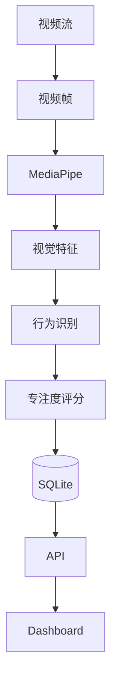

# 数据流设计

## 1. 数据来源

系统数据主要来自：

- 摄像头视频流
- 学生基本信息
- 历史检测记录

---

## 2. 数据处理流程

---

## 3. 数据内容

视觉特征：

- EAR
- MAR
- Pitch
- Roll
- Yaw
- Pose
- Gaze

最终生成：

Student Status。

---

## 4. 数据流原则

- 单向流动
- 不重复计算
- 特征统一管理
- 数据统一保存