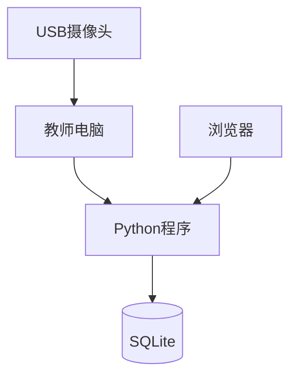

# 部署图

## 1. 部署结构

---

## 2. 第一阶段部署

系统运行于单台 Windows PC。

部署内容：

- Python 3.11
- OpenCV
- MediaPipe
- Flask
- SQLite

无需服务器即可完成开发与演示。

---

## 3. 后续部署

后续版本可扩展为：

- Linux服务器
- MySQL数据库
- InfluxDB时序数据库
- Docker部署
- Nginx反向代理

实现多终端访问和长期运行。