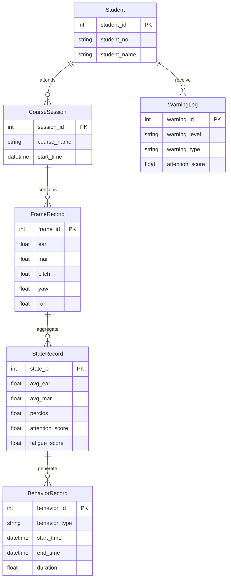

# ER图

## 数据实体关系

## 设计说明

数据库采用"原始数据 + 聚合数据"双层存储模式。

* FrameRecord 保存每帧原始视觉特征，用于科研分析与模型训练。
* StateRecord 保存每秒聚合统计结果，用于系统展示和风险分析。
* BehaviorRecord 保存行为事件，而非每帧状态，提高查询效率。
* WarningLog 保存预警信息，为教师端提供风险提示。
