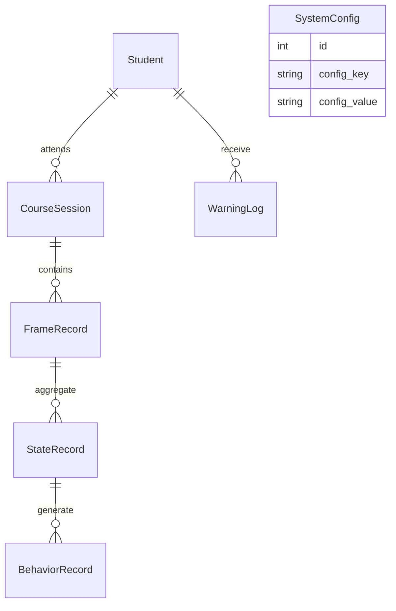

# 数据库设计

## 1. 数据库概述

本项目采用分阶段数据库设计方案，以满足科研实验与工程开发的双重需求。

第一阶段（V0.1～V0.3）采用 SQLite 作为本地数据库，用于快速开发、调试和演示。

第二阶段（V0.4 以后）支持迁移至 MySQL，并预留 InfluxDB 接入能力，用于高频时序数据存储。

数据库设计遵循以下原则：

* 数据规范化
* 模块解耦
* 可扩展
* 支持科研数据采集
* 支持机器学习训练

---

# 2. 数据库总体结构



---

# 3. 数据表

| 表名             | 功能             |
| -------------- | -------------- |
| Student        | 学生信息           |
| CourseSession  | 课堂信息           |
| FrameRecord    | 原始视觉数据（科研）     |
| StateRecord    | 每秒统计数据（系统主要使用） |
| BehaviorRecord | 行为事件记录         |
| WarningLog     | 风险预警           |
| SystemConfig   | 系统配置           |

---

# 4. Student

```sql
CREATE TABLE Student(
    student_id INTEGER PRIMARY KEY AUTOINCREMENT,
    student_no TEXT UNIQUE,
    student_name TEXT,
    gender TEXT,
    class_name TEXT,
    major TEXT,
    create_time DATETIME DEFAULT CURRENT_TIMESTAMP
);
```

---

# 5. CourseSession

```sql
CREATE TABLE CourseSession(
    session_id INTEGER PRIMARY KEY AUTOINCREMENT,
    course_name TEXT,
    teacher_name TEXT,
    classroom TEXT,
    start_time DATETIME,
    end_time DATETIME
);
```

---

# 6. FrameRecord（科研原始数据）

FrameRecord 用于保存 MediaPipe 每一帧计算得到的原始视觉特征，仅用于科研实验、模型训练及算法验证。

```sql
CREATE TABLE FrameRecord(
    frame_id INTEGER PRIMARY KEY AUTOINCREMENT,
    student_id INTEGER,
    session_id INTEGER,
    frame_time DATETIME,

    ear REAL,
    mar REAL,

    pitch REAL,
    yaw REAL,
    roll REAL,

    FOREIGN KEY(student_id)
        REFERENCES Student(student_id),

    FOREIGN KEY(session_id)
        REFERENCES CourseSession(session_id)
);
```

> 注：FrameRecord 默认可配置开启或关闭保存，以避免长期运行导致数据库体积快速增长。

---

# 7. StateRecord（系统核心数据）

StateRecord 为每秒聚合一次的数据，是系统查询、统计和机器学习的主要数据来源。

```sql
CREATE TABLE StateRecord(
    state_id INTEGER PRIMARY KEY AUTOINCREMENT,

    student_id INTEGER,

    session_id INTEGER,

    record_time DATETIME,

    avg_ear REAL,

    avg_mar REAL,

    avg_pitch REAL,

    avg_yaw REAL,

    avg_roll REAL,

    perclos REAL,

    attention_score REAL,

    fatigue_score REAL,

    FOREIGN KEY(student_id)
        REFERENCES Student(student_id),

    FOREIGN KEY(session_id)
        REFERENCES CourseSession(session_id)
);
```

---

# 8. BehaviorRecord（行为事件）

行为记录不再保存大量布尔值，而是采用事件模型。

```sql
CREATE TABLE BehaviorRecord(
    behavior_id INTEGER PRIMARY KEY AUTOINCREMENT,

    student_id INTEGER,

    session_id INTEGER,

    behavior_type TEXT,

    start_time DATETIME,

    end_time DATETIME,

    duration REAL
);
```

behavior_type 包括：

* blink
* yawn
* head_down
* looking_away
* absent

---

# 9. WarningLog

```sql
CREATE TABLE WarningLog(
    warning_id INTEGER PRIMARY KEY AUTOINCREMENT,

    student_id INTEGER,

    session_id INTEGER,

    warning_level TEXT,

    warning_type TEXT,

    warning_reason TEXT,

    attention_score REAL,

    create_time DATETIME,

    processed INTEGER DEFAULT 0
);
```

---

# 10. SystemConfig

```sql
CREATE TABLE SystemConfig(
    id INTEGER PRIMARY KEY AUTOINCREMENT,

    config_key TEXT,

    config_value TEXT
);
```

---

# 11. 数据流

```text
Camera
    ↓
MediaPipe
    ↓
FrameRecord（原始数据）
    ↓
每秒聚合
    ↓
StateRecord
    ↓
BehaviorRecord
    ↓
WarningLog
    ↓
Dashboard
```

---

# 12. 后续扩展

后续版本可增加：

* FeatureRecord（机器学习特征）
* EmotionRecord（情绪识别）
* AttendanceRecord（签到）
* ModelResult（模型预测结果）

数据库结构预留扩展能力，不影响现有系统运行。
