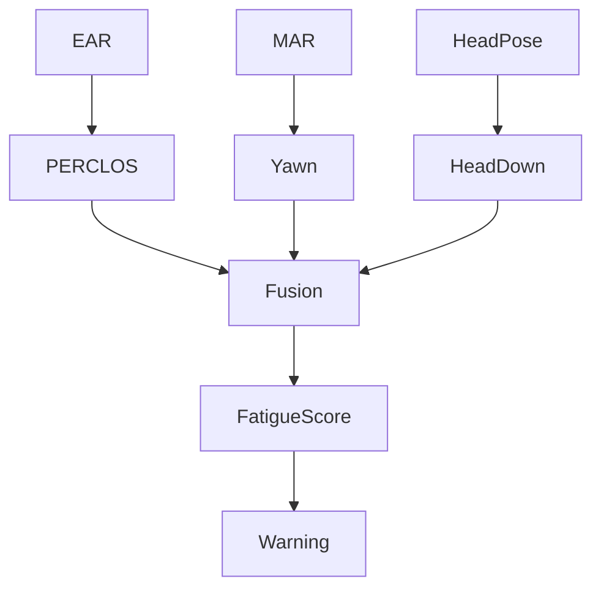

# Fatigue —— 疲劳检测模块设计

## 1. 模块概述

疲劳检测（Fatigue Detection）模块用于分析学生在课堂过程中的疲劳状态，是本系统行为分析与学业风险预警的重要组成部分。

传统课堂观察主要依赖教师主观判断，难以连续、客观地评估学生疲劳程度。本项目结合计算机视觉技术，通过眼部状态、头部姿态及嘴部动作等多种视觉特征构建疲劳评估模型，实现课堂疲劳状态的实时监测。

本模块采用多指标融合策略，而非仅依赖单一指标，以提高复杂课堂环境下的检测稳定性和准确率。

---

# 2. 模块定位

Fatigue 模块位于行为分析层。

```text
USB Camera
      │
      ▼
Face Detection
      │
      ▼
MediaPipe
      │
      ├────────► EyeEAR
      │
      ├────────► HeadPose
      │
      └────────► MouthMAR
                │
                ▼
        Fatigue Detection
                │
                ▼
        Warning System
                │
                ▼
         Database
```

本模块不直接处理图像，而是融合多个视觉模块输出的数据。

---

# 3. 疲劳特征来源

本项目采用多模态视觉特征进行疲劳分析。

| 特征 | 来源 | 作用 |
|------|------|------|
| EAR | EyeEAR | 判断眼睛闭合 |
| PERCLOS | EyeEAR | 判断持续闭眼比例 |
| Blink Rate | EyeEAR | 判断眨眼频率变化 |
| MAR | Mouth | 判断打哈欠 |
| Head Pose | HeadPose | 判断持续低头 |
| Face Lost | FaceDetection | 判断是否离开画面 |

其中 PERCLOS 为主要指标。

---

# 4. PERCLOS 指标

PERCLOS（Percentage of Eye Closure）是国际上应用最广泛的视觉疲劳检测指标。

定义如下：

```text
PERCLOS

=

闭眼帧数

/

总帧数
```

例如：

```text
60 秒

共1800帧

闭眼420帧

PERCLOS

=

420 / 1800

=

23.3%
```

一般情况下：

| PERCLOS | 状态 |
|----------|------|
| <15% | 正常 |
| 15%~25% | 轻度疲劳 |
| 25%~40% | 中度疲劳 |
| >40% | 重度疲劳 |

阈值可根据实验数据进一步调整。

---

# 5. 打哈欠检测

打哈欠通过 Mouth Aspect Ratio（MAR）进行检测。

MAR 持续高于阈值时，认为发生一次打哈欠事件。

记录内容：

```text
Yawn Event

开始时间

结束时间

持续时间
```

统计：

- 每分钟打哈欠次数
- 单次持续时间
- 总持续时间

---

# 6. 头部疲劳行为

课堂疲劳通常伴随持续低头。

采用 Pitch 判断：

| Pitch | 判断 |
|---------|------|
| <20° | 正常 |
| 20°~35° | 轻度低头 |
| >35° | 长时间低头 |

若持续超过设定时间：

```text
5 秒
```

则记录：

```text
Head Down Event
```

---

# 7. 综合疲劳评分

为了提高检测稳定性，本项目采用加权融合方法计算疲劳评分。

建议公式：

```text
Fatigue Score

=

0.50 × PERCLOS

+

0.20 × Blink Rate

+

0.15 × Head Down

+

0.15 × Yawn
```

最终结果归一化到：

```text
0 ~ 100
```

数值越高表示疲劳程度越严重。

---

# 8. 疲劳等级划分

根据综合评分划分疲劳等级。

| Fatigue Score | 等级 |
|---------------|------|
| 0~30 | 正常 |
| 30~60 | 轻度疲劳 |
| 60~80 | 中度疲劳 |
| 80~100 | 重度疲劳 |

不同等级可触发不同预警策略。

---

# 9. 数据输出

统一输出：

```text
FatigueResult

├── perclos
├── blink_rate
├── yawn_rate
├── head_down_duration
├── fatigue_score
├── fatigue_level
└── confidence
```

其中：

| 字段 | 说明 |
|------|------|
| perclos | 闭眼比例 |
| blink_rate | 眨眼频率 |
| yawn_rate | 打哈欠频率 |
| head_down_duration | 累计低头时间 |
| fatigue_score | 综合评分 |
| fatigue_level | 疲劳等级 |
| confidence | 可信度 |

---

# 10. 数据库存储

建议：

StateRecord 保存：

- perclos
- fatigue_score

BehaviorRecord 保存：

```text
Blink

Yawn

HeadDown
```

WarningLog 保存：

```text
Warning Type

Fatigue

Reason

High Fatigue Score
```

避免重复记录原始数据，提高数据库效率。

---

# 11. 疲劳检测流程



---

# 12. 异常处理

系统需处理：

| 异常 | 处理方式 |
|------|-----------|
| 人脸丢失 | 暂停疲劳计算 |
| Landmark 缺失 | 跳过当前帧 |
| 遮挡 | 降低可信度 |
| 摄像头异常 | 停止统计 |
| 长时间无人 | 重置状态 |

所有异常均记录日志。

---

# 13. 性能要求

| 指标 | 要求 |
|------|------|
| 实时处理 | ≥20 FPS |
| 单帧融合计算 | ≤2 ms |
| CPU 占用 | ≤5% |
| 延迟 | ≤100 ms |

Fatigue 模块仅负责特征融合，不进行复杂模型推理，因此能够满足实时课堂监测需求。

---

# 14. 与其他模块关系

Fatigue 模块依赖多个视觉模块。

```text
EyeEAR
      │
HeadPose
      │
MouthMAR
      │
      ▼
Fatigue
      │
      ├── StateRecord
      ├── WarningLog
      ├── Engagement
      └── Machine Learning
```

疲劳评分不仅用于实时预警，也作为机器学习模型的重要输入特征。

---

# 15. 后续优化

后续版本计划增加以下能力：

- 引入时序模型（LSTM）分析疲劳变化趋势，而非仅依据当前窗口评分；
- 基于个体历史数据建立自适应疲劳阈值，提高不同学生之间的适应性；
- 引入眼部闭合持续时间、眨眼间隔、头部运动频率等高级统计特征；
- 结合课堂时间（如课程后半段）调整疲劳判定策略；
- 融合环境因素（光照、摄像头质量）进行可信度修正；
- 将疲劳评分作为学业风险预测模型的重要输入，与课堂参与度、历史成绩等数据共同构建多模态预警模型。

Fatigue 模块是课堂状态分析的重要组成部分，其输出的疲劳评分（Fatigue Score）将直接参与学生课堂状态评估，并为后续机器学习模型提供关键输入特征。