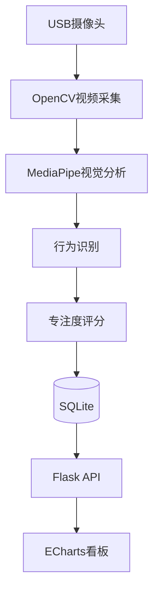

# 系统架构

## 1. 总体架构

本系统采用模块化架构设计，各功能模块职责明确，模块之间通过统一接口进行数据交互。

系统整体分为六层：

1. 数据采集层
2. 视觉分析层
3. 业务处理层
4. 数据存储层
5. 服务层
6. 展示层

---

## 2. 系统架构图

---

## 3. 模块说明

### 数据采集层

负责摄像头初始化、视频读取、帧缓存及异常处理。

主要技术：

- OpenCV

---

### 视觉分析层

负责：

- 人脸检测
- Face Mesh
- Pose
- Head Pose
- EAR
- PERCLOS

输出统一视觉特征。

---

### 业务处理层

负责：

- 行为识别
- 专注度计算
- 疲劳判断
- 风险评分

---

### 数据存储层

第一阶段采用 SQLite。

后期支持：

- MySQL
- InfluxDB

---

### 服务层

提供：

REST API

负责前后端数据交换。

---

### 展示层

教师端：

- 班级状态
- 学生详情
- 历史曲线
- 风险统计

采用：

Flask + ECharts。