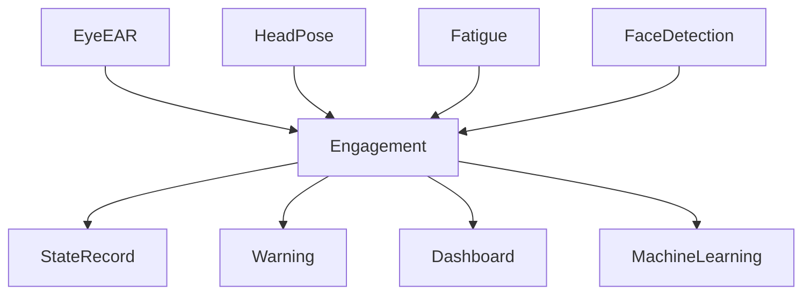

# Engagement —— 课堂参与度分析模块设计

## 1. 模块概述

课堂参与度（Engagement）是衡量学生课堂学习状态的重要指标。本项目中的 Engagement 模块负责融合多个视觉特征，对学生在课堂中的专注程度进行实时量化分析，并生成统一的课堂参与度评分（Engagement Score）。

需要说明的是，本项目所定义的课堂参与度并非心理学意义上的“学习兴趣”或“学习投入”，而是基于计算机视觉能够观测到的客观行为特征，对学生课堂状态进行工程化量化。

因此，本模块输出的是一种**视觉参与度（Visual Engagement）**，主要反映学生是否持续关注课堂、是否存在明显疲劳或注意力分散行为，为教师课堂管理和后续机器学习模型提供客观数据支持。

---

# 2. 模块定位

Engagement 是整个视觉分析模块的最终融合模块。

```text
Camera
      │
      ▼
Face Detection
      │
      ▼
MediaPipe
      │
 ┌────┼─────────────┐
 │    │             │
 ▼    ▼             ▼
EyeEAR HeadPose   Behavior
 │    │             │
 └────┴─────────────┘
          │
          ▼
   Engagement Score
          │
          ├────────► Database
          ├────────► Dashboard
          ├────────► Warning
          └────────► Machine Learning
```

本模块不直接处理图像，仅负责融合多个视觉分析模块的输出结果。

---

# 3. 模块目标

Engagement 模块主要完成以下任务：

| 功能 | 描述 |
|------|------|
| 综合课堂行为分析 | 融合多个视觉特征 |
| 实时评分 | 输出课堂参与度分数 |
| 状态分类 | 判断学生课堂状态 |
| 数据存储 | 保存参与度评分 |
| 风险提示 | 为预警模块提供依据 |

---

# 4. 输入特征

课堂参与度采用多特征融合策略。

第一阶段使用以下视觉特征：

| 特征 | 来源 | 作用 |
|------|------|------|
| EAR | EyeEAR | 判断是否闭眼 |
| PERCLOS | Fatigue | 判断疲劳程度 |
| Fatigue Score | Fatigue | 综合疲劳 |
| Pitch | HeadPose | 是否低头 |
| Yaw | HeadPose | 是否偏头 |
| Blink Rate | EyeEAR | 眨眼频率 |
| Face Lost | Face Detection | 是否离开画面 |

后续版本可增加：

- 表情识别
- 手势识别
- 身体姿态
- 语音分析（可选）

---

# 5. 参与度评价思想

课堂参与度不能依赖单一指标。

例如：

- 睁眼并不代表认真听课；
- 低头可能是在记笔记；
- 偏头可能是在观看投影。

因此，本项目采用**多指标综合评价**的方法。

系统综合分析：

- 是否持续注视前方；
- 是否存在明显疲劳；
- 是否频繁离开摄像头；
- 是否存在异常头部姿态；
- 是否存在持续注意力下降。

最终输出统一评分。

---

# 6. 综合评分模型

第一阶段采用加权评分模型。

建议计算方式：

```text
Engagement Score

=

0.35 × Eye Score

+

0.25 × Head Pose Score

+

0.25 × Fatigue Score

+

0.15 × Attendance Score
```

其中：

Eye Score：

根据 EAR、Blink、PERCLOS 计算。

Head Pose Score：

根据 Pitch、Yaw、Roll 计算。

Fatigue Score：

由 Fatigue 模块提供。

Attendance Score：

根据 Face Detection 判断学生是否持续出现在画面中。

最终统一转换为：

```text
0~100 分
```

---

# 7. 状态划分

根据参与度评分划分课堂状态。

| Engagement Score | 状态 |
|-----------------|------|
| 80~100 | 高参与 |
| 60~80 | 正常参与 |
| 40~60 | 注意力下降 |
| 20~40 | 低参与 |
| 0~20 | 严重分心 |

系统可根据课堂需求调整阈值。

---

# 8. 时间窗口

课堂状态具有连续性。

因此，本项目不采用单帧评分，而采用滑动窗口统计。

建议：

```text
窗口长度：

30 秒

更新时间：

1 秒
```

即：

每秒计算一次过去 30 秒的课堂参与度。

这样能够减少瞬时动作造成的误判。

---

# 9. 数据输出

统一输出：

```text
EngagementResult

├── engagement_score
├── engagement_level
├── attention_state
├── update_time
└── confidence
```

说明：

| 字段 | 含义 |
|------|------|
| engagement_score | 综合评分 |
| engagement_level | 等级 |
| attention_state | 当前状态 |
| update_time | 更新时间 |
| confidence | 可信度 |

---

# 10. 数据库存储

建议：

StateRecord 保存：

```text
attention_score

fatigue_score

perclos
```

BehaviorRecord 保存：

```text
HeadDown

Blink

Yawn

LookingAway
```

WarningLog 保存：

```text
Low Engagement

Long Fatigue

Absent
```

这样数据库既能保存统计信息，也能保存行为事件。

---

# 11. 风险预警

参与度持续下降时，可触发预警。

建议：

| 条件 | 处理方式 |
|------|----------|
| 连续5分钟低于40分 | 一级提醒 |
| 连续10分钟低于30分 | 二级预警 |
| 长时间无人脸 | 缺勤提示 |

预警信息保存至 WarningLog。

---

# 12. 数据流程



---

# 13. 性能要求

| 指标 | 要求 |
|------|------|
| 更新周期 | 1 秒 |
| 单次融合计算 | ≤5 ms |
| CPU 占用 | ≤5% |
| 支持人数 | ≥30 人 |

由于本模块主要进行特征融合和评分计算，不涉及复杂图像处理，因此能够满足实时课堂分析需求。

---

# 14. 与其他模块关系

Engagement 是视觉分析模块的最终输出。

```text
FaceDetection
      │
MediaPipe
      │
EyeEAR
      │
HeadPose
      │
Fatigue
      │
      ▼
Engagement
      │
      ├── Database
      ├── Dashboard
      ├── Warning
      └── Machine Learning
```

数据库中的 `StateRecord.attention_score` 即由本模块生成，并作为课堂可视化、统计分析及机器学习模型的重要输入特征。

---

# 15. 后续优化

当前版本采用规则驱动的综合评分模型，具有实现简单、可解释性强、便于调试的优点。

后续版本计划逐步升级为数据驱动模型：

1. 基于历史课堂数据自动学习各特征权重；
2. 引入 XGBoost 建立课堂参与度预测模型；
3. 使用 LSTM 分析学生参与度的时间变化趋势；
4. 利用 SHAP 分析各视觉特征对参与度评分的贡献，提高模型可解释性；
5. 支持教师根据不同课程场景自定义评分策略和预警阈值。

最终形成"视觉特征提取 → 状态融合 → 参与度评分 → 风险预测"的完整分析链路，为学生课堂学习状态评估提供可靠的数据支撑。