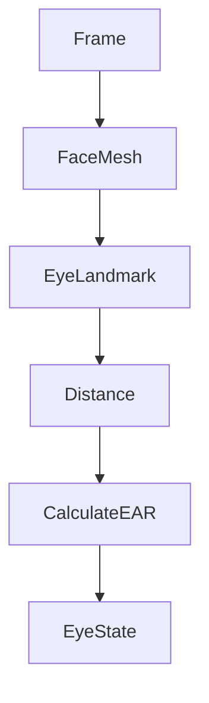

# EyeEAR —— 眼部状态检测模块设计

## 1. 模块概述

EyeEAR（Eye Aspect Ratio，眼部纵横比）模块用于实时检测学生眼睛开闭状态，是本系统疲劳检测、课堂专注度分析及行为识别的重要组成部分。

相比传统阈值分割、模板匹配等方法，EAR 算法具有计算简单、实时性高、对光照变化适应性较强等优点。本项目采用 MediaPipe Face Mesh 提供的眼部关键点，通过计算眼睛纵横比（EAR）判断学生是否闭眼、眨眼及长时间闭眼，并进一步计算 PERCLOS 疲劳指标。

本模块输出的数据包括：

- 左眼 EAR
- 右眼 EAR
- 平均 EAR
- 是否闭眼
- 是否发生眨眼
- PERCLOS（后续统计）

上述数据将作为 Fatigue 模块、Engagement 模块及机器学习模型的重要输入。

---

# 2. 模块位置

EyeEAR 位于 Face Mesh 与 Fatigue 模块之间。

```text
USB Camera
      │
      ▼
Face Detection
      │
      ▼
MediaPipe Face Mesh
      │
      ▼
EyeEAR
      │
      ├────────► Fatigue
      │
      ├────────► Engagement
      │
      ├────────► Database
      │
      └────────► Machine Learning
```

---

# 3. EAR 算法原理

EAR（Eye Aspect Ratio）通过眼部六个关键点之间的距离关系描述眼睛张开程度。

眼睛睁开时：

- 垂直距离较大
- EAR 值较高

眼睛闭合时：

- 垂直距离趋近于零
- EAR 值迅速下降

因此，可利用 EAR 判断眼睛开闭状态。

---

# 4. 数学模型

设眼部六个关键点分别为：

```text
P1
P2
P3
P4
P5
P6
```

对应关系：

```text
P2      P3
 ●------●

P1        P4

 ●------●
P6      P5
```

EAR 定义如下：

```text
EAR = ( ||P2-P6|| + ||P3-P5|| )
      -------------------------
          2 × ||P1-P4||
```

其中：

- 分子表示两组垂直距离
- 分母表示水平距离

EAR 为无量纲比例值。

---

# 5. MediaPipe Landmark

本项目采用 Face Mesh Landmark。

左眼建议使用：

| Landmark |
|----------|
| 33 |
| 160 |
| 158 |
| 133 |
| 153 |
| 144 |

右眼建议使用：

| Landmark |
|----------|
| 362 |
| 385 |
| 387 |
| 263 |
| 373 |
| 380 |

统一采用上述编号，保证后续算法一致性。

---

# 6. EAR 计算流程



流程说明：

1. 获取 Face Mesh。
2. 提取左右眼 Landmark。
3. 计算欧氏距离。
4. 根据公式计算 EAR。
5. 判断眼睛状态。

---

# 7. 双眼融合策略

由于课堂环境存在遮挡、侧脸等情况，仅使用单眼容易产生误判。

本项目采用双眼平均值：

```text
EARmean

=

(EARleft + EARright)

/

2
```

若一侧眼睛关键点缺失，则使用另一侧计算结果。

---

# 8. 阈值设计

课堂环境建议参数如下：

| 参数 | 建议值 |
|------|---------|
| EAR Threshold | 0.20 |
| Blink Frames | ≥3 帧 |
| Closed Frames | ≥15 帧 |

判定规则：

| 条件 | 判断 |
|------|------|
| EAR ≥ Threshold | 睁眼 |
| EAR < Threshold | 闭眼 |

连续闭眼超过设定帧数，则判定为长时间闭眼。

---

# 9. 眨眼检测

眨眼属于短时间闭眼事件。

判断流程：

```text
EAR下降

↓

EAR低于阈值

↓

持续3~10帧

↓

EAR恢复

↓

Blink
```

输出：

```text
Blink Event

Start Time

End Time

Duration
```

事件将保存至 BehaviorRecord。

---

# 10. PERCLOS 计算

PERCLOS（Percentage of Eye Closure）用于描述一段时间内眼睛闭合比例，是国际上广泛应用的疲劳检测指标。

计算公式：

```text
PERCLOS

=

闭眼帧数

/

总帧数
```

例如：

```text
一分钟：

1800 帧

闭眼：

360 帧

PERCLOS

=

360 / 1800

=

20%
```

PERCLOS 越高，疲劳程度越高。

系统默认统计窗口：

```text
60 秒
```

每秒更新一次。

---

# 11. 数据输出

统一输出：

```text
EyeStateResult

├── left_ear
├── right_ear
├── average_ear
├── eye_state
├── blink
├── perclos
└── confidence
```

说明：

| 字段 | 含义 |
|------|------|
| left_ear | 左眼 EAR |
| right_ear | 右眼 EAR |
| average_ear | 平均 EAR |
| eye_state | 睁眼/闭眼 |
| blink | 是否发生眨眼 |
| perclos | 疲劳指标 |
| confidence | 可信度 |

---

# 12. 数据库存储

建议：

FrameRecord 保存：

- ear

StateRecord 保存：

- avg_ear
- perclos

BehaviorRecord 保存：

```text
Blink

Start Time

End Time

Duration
```

避免每帧重复存储行为状态。

---

# 13. 异常处理

系统需处理：

| 异常 | 处理方式 |
|------|-----------|
| 人脸丢失 | 返回空结果 |
| Landmark 缺失 | 跳过当前帧 |
| 单眼遮挡 | 使用另一侧眼睛 |
| 双眼遮挡 | 标记 Unknown |
| 图像模糊 | 降低可信度 |

所有异常均记录日志。

---

# 14. 性能要求

| 指标 | 要求 |
|------|------|
| 单帧计算时间 | ≤3 ms |
| FPS | ≥20 |
| EAR 计算误差 | ≤5% |
| CPU 占用 | ≤5% |

EyeEAR 为轻量级模块，应保证实时运行。

---

# 15. 与其他模块关系

EyeEAR 输出数据将提供给：

```text
EyeEAR
    │
    ├── Fatigue（疲劳检测）
    ├── Engagement（课堂参与度）
    ├── StateRecord（数据库）
    ├── BehaviorRecord（眨眼事件）
    └── Machine Learning（特征工程）
```

其中：

- average_ear 为课堂状态的重要指标；
- perclos 为疲劳检测核心指标；
- blink_rate（单位时间眨眼次数）将在 Feature Engineering 阶段统计生成。

---

# 16. 后续优化

后续版本计划增加以下能力：

- 基于时间序列的 EAR 平滑滤波，降低关键点抖动带来的误判；
- 自适应阈值，根据学生个体差异动态调整 EAR Threshold；
- Blink Rate（眨眼频率）统计，计算单位时间眨眼次数；
- 双眼置信度融合，提高侧脸和遮挡场景下的鲁棒性；
- 与 HeadPose 联合分析，减少因低头、转头导致的误检；
- 将 EAR、PERCLOS、Blink Rate 等特征统一输出至机器学习模块，用于课堂状态预测和学业风险预警。

EyeEAR 模块是整个视觉分析系统的重要基础，其输出结果将直接影响疲劳检测、课堂参与度分析及后续智能预警模型的准确性，因此需要保证算法稳定、接口统一、计算高效。