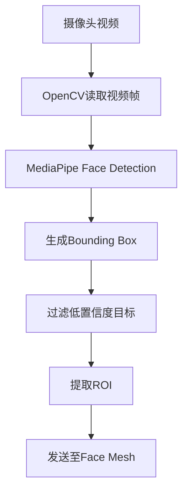

# FaceDetection —— 人脸检测模块设计

## 1. 模块概述

人脸检测（Face Detection）是整个视觉分析系统的入口模块，其主要任务是在摄像头实时采集的视频流中快速定位学生人脸区域（Region of Interest，ROI），为后续的人脸关键点检测、头部姿态估计、眼部状态分析和课堂行为识别提供输入。

本项目采用 Google MediaPipe Face Detection 作为第一阶段的人脸检测方案。该方案具有轻量级、高实时性、跨平台支持良好等特点，在普通 CPU 环境下即可满足课堂实时检测需求。

本模块的主要输出包括：

- 人脸边界框（Bounding Box）
- 人脸检测置信度（Confidence）
- 人脸中心坐标
- 人脸 ROI 区域

这些结果将直接传递给 Face Mesh 模块进行 468 个关键点定位。

---

# 2. 模块位置

本模块位于整个视觉处理流水线的第一步。

```text
USB Camera
      │
      ▼
Frame Capture
      │
      ▼
Face Detection
      │
      ▼
Face Mesh (468 Landmark)
      │
      ▼
Head Pose
      │
      ▼
EAR / MAR
      │
      ▼
Behavior Analysis
      │
      ▼
Database
```

因此，本模块要求具有较高的检测速度和稳定性。

---

# 3. 功能需求

FaceDetection 模块需要完成以下功能：

| 功能 | 描述 |
|------|------|
| 摄像头图像输入 | 接收 OpenCV 视频帧 |
| 人脸检测 | 检测图像中的学生人脸 |
| 多人支持 | 支持课堂多人检测（可配置） |
| ROI 输出 | 返回每个人脸区域 |
| 检测置信度 | 返回检测可信度 |
| 数据传递 | 将 ROI 交给 Face Mesh 模块 |

---

# 4. 技术方案比较

项目初期对几种常见的人脸检测算法进行了比较。

| 方法 | 优点 | 缺点 |
|------|------|------|
| Haar Cascade | 实现简单，速度快 | 精度低，抗遮挡能力差 |
| Dlib HOG | 精度较高 | CPU 占用较高 |
| RetinaFace | 精度最高 | 模型较大，实时性一般 |
| YOLO Face | 可检测复杂场景 | 部署成本较高 |
| **MediaPipe Face Detection** | 实时性高、跨平台、与 Face Mesh 无缝结合 | 极端姿态下精度略有下降 |

综合实时性、开发难度及后续模块兼容性，本项目选择 **MediaPipe Face Detection** 作为人脸检测方案。

---

# 5. 输入与输出

## 输入

输入为 OpenCV 获取的彩色视频帧。

```python
frame: numpy.ndarray
```

数据来源：

- USB 摄像头
- OpenCV VideoCapture

---

## 输出

输出定义如下：

```python
FaceDetectionResult

├── face_id
├── confidence
├── bbox
├── center_x
├── center_y
└── roi
```

其中：

| 字段 | 含义 |
|------|------|
| face_id | 人脸编号 |
| confidence | 检测置信度 |
| bbox | 人脸边界框 |
| center_x | 中心 X 坐标 |
| center_y | 中心 Y 坐标 |
| roi | 人脸区域图像 |

---

# 6. 工作流程

Face Detection 的处理流程如下：



整个流程对每一帧图像执行一次。

---

# 7. 参数设置

建议采用如下参数。

| 参数 | 建议值 | 说明 |
|------|---------|------|
| model_selection | 0 | 短距离检测模式 |
| min_detection_confidence | 0.5 | 最低检测置信度 |
| max_faces | 10 | 最大检测人数 |
| image_size | 640×480 | 推荐输入分辨率 |

上述参数可根据实际课堂环境进行调整。

---

# 8. 异常处理

为了提高系统稳定性，本模块需要处理以下异常情况：

| 异常 | 处理方式 |
|------|-----------|
| 摄像头断开 | 自动重新连接 |
| 未检测到人脸 | 返回空结果，不中断程序 |
| 多人重叠 | 保留全部检测结果 |
| 光照不足 | 降低检测阈值（可选） |
| 图像模糊 | 标记当前帧无效 |

所有异常均记录至系统日志。

---

# 9. 性能要求

本模块应满足以下性能指标。

| 指标 | 要求 |
|------|------|
| 检测速度 | ≥20 FPS |
| 单帧检测时间 | ≤20 ms |
| CPU 占用 | 尽量低于 30% |
| 检测成功率 | 正常光照下 ≥95% |

---

# 10. 与其他模块关系

FaceDetection 模块仅负责定位人脸，不负责行为分析。

其输出将作为以下模块的输入：

- MediaPipe Face Mesh
- Head Pose
- Eye EAR
- Mouth MAR
- Fatigue
- Engagement

因此，本模块是整个视觉分析系统的数据入口。

---

# 11. 后续优化方向

随着项目版本升级，可进一步优化：

- 增加人脸跟踪（Face Tracking），减少重复检测。
- 引入 ByteTrack 或 DeepSORT，实现学生身份持续跟踪。
- 支持复杂光照和遮挡环境下的人脸检测。
- 增加 GPU 推理支持，提高实时性能。
- 支持多人课堂的大规模检测与编号管理。

以上优化不影响当前系统架构，可在后续版本逐步实现。