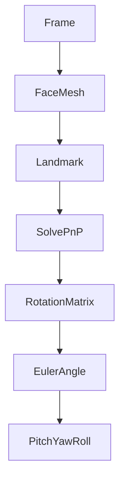

# HeadPose —— 头部姿态估计模块设计

## 1. 模块概述

头部姿态估计（Head Pose Estimation）用于计算学生头部在三维空间中的朝向，是课堂行为分析的重要组成部分。本模块基于 MediaPipe Face Mesh 提供的人脸关键点，结合 OpenCV 的 Perspective-n-Point（PnP）算法，计算头部绕三个坐标轴的旋转角度（Pitch、Yaw、Roll）。

相比仅依赖眼部状态进行疲劳检测，头部姿态能够更准确反映学生的课堂行为，例如低头、左右张望、长时间偏离屏幕等，是课堂专注度评估的重要依据。

本模块输出的姿态数据将用于：

- 判断学生是否低头
- 判断学生是否长时间偏头
- 辅助课堂参与度（Engagement）计算
- 辅助疲劳检测（Fatigue）
- 为机器学习模型提供姿态特征

---

# 2. 模块位置

HeadPose 位于视觉处理流程中 Face Mesh 之后。

```text
USB Camera
      │
      ▼
OpenCV 视频采集
      │
      ▼
Face Detection
      │
      ▼
MediaPipe Face Mesh
      │
      ▼
Head Pose Estimation
      │
      ├────────► Fatigue
      │
      ├────────► Engagement
      │
      ├────────► Database
      │
      └────────► Machine Learning
```

本模块依赖于 Face Mesh 输出的人脸关键点，不直接处理原始图像。

---

# 3. 模块目标

HeadPose 模块需完成以下任务：

| 功能 | 描述 |
|------|------|
| 三维姿态估计 | 计算 Pitch、Yaw、Roll |
| 姿态分类 | 判断正常、低头、偏头等状态 |
| 数据输出 | 为后续模块提供统一姿态数据 |
| 实时运行 | 满足课堂实时分析需求 |

---

# 4. 姿态角定义

头部姿态采用欧拉角（Euler Angle）表示。

包括三个角度：

| 名称 | 含义 | 旋转轴 |
|------|------|--------|
| Pitch | 点头（上下） | X轴 |
| Yaw | 转头（左右） | Y轴 |
| Roll | 歪头（倾斜） | Z轴 |

示意：

```text
           Pitch

             ▲
             │
      Roll ◄─●─► Roll

             │
             ▼

            Yaw
```

课堂分析中主要关注 Pitch 与 Yaw。

---

# 5. 数学原理

HeadPose 基于 Perspective-n-Point（PnP）问题。

目标：

已知：

- 三维人脸模型坐标（3D）
- 图像二维关键点（2D）

求解：

- Rotation Vector（旋转向量）
- Translation Vector（平移向量）

OpenCV 提供：

```python
cv2.solvePnP()
```

求解公式：

```text
3D Face Model

        +

2D Image Points

        ↓

Perspective-n-Point

        ↓

Rotation Matrix

        ↓

Euler Angle

(Pitch Yaw Roll)
```

最终转换为欧拉角作为系统输出。

---

# 6. Landmark 选择

MediaPipe Face Mesh 提供 468 个关键点。

实际 HeadPose 只需少量稳定关键点。

建议采用：

| Landmark | 部位 |
|-----------|------|
| 1 | Nose Tip |
| 33 | Left Eye |
| 263 | Right Eye |
| 61 | Left Mouth Corner |
| 291 | Right Mouth Corner |
| 152 | Chin |

这些点空间分布均匀，能够稳定构建三维人脸模型。

---

# 7. 相机模型

PnP 求解需要相机内参。

本项目采用近似模型：

```python
fx = image_width

fy = image_width

cx = image_width / 2

cy = image_height / 2
```

得到：

```python
camera_matrix =
[
 [fx,0,cx],
 [0,fy,cy],
 [0,0,1]
]
```

畸变参数：

```python
dist_coeffs = np.zeros((4,1))
```

开发阶段可忽略镜头畸变。

---

# 8. 姿态计算流程



整个过程对每帧执行一次。

---

# 9. 姿态分类规则

系统根据 Pitch、Yaw 判断课堂行为。

建议阈值如下：

| 条件 | 判断 |
|------|------|
| Pitch < 20° | 正常 |
| Pitch ≥ 20° | 轻度低头 |
| Pitch ≥ 35° | 明显低头 |
| Yaw < 25° | 正常 |
| Yaw ≥ 25° | 左右偏头 |
| Roll ≥ 20° | 身体倾斜 |

连续超过设定时间后，可触发行为事件。

---

# 10. 数据输出

统一输出数据结构：

```text
HeadPoseResult

├── pitch
├── yaw
├── roll
├── pose_status
└── confidence
```

说明：

| 字段 | 描述 |
|------|------|
| pitch | 上下角度 |
| yaw | 左右角度 |
| roll | 倾斜角度 |
| pose_status | 姿态分类 |
| confidence | 计算可信度 |

---

# 11. 行为判定

根据姿态变化可识别课堂行为。

| 行为 | 判定条件 |
|------|----------|
| 正常听课 | Pitch、Yaw 均正常 |
| 长时间低头 | Pitch 持续超过阈值 |
| 左右张望 | Yaw 持续超过阈值 |
| 身体倾斜 | Roll 持续超过阈值 |
| 离开摄像头 | 无法检测关键点 |

行为事件将发送至 BehaviorRecord。

---

# 12. 异常处理

系统需处理以下情况：

| 异常 | 处理方式 |
|------|-----------|
| Landmark 丢失 | 跳过当前帧 |
| 人脸遮挡 | 保持上一帧结果（可选） |
| 检测失败 | 输出 Unknown |
| 姿态剧烈变化 | 使用平滑滤波 |

建议采用滑动平均或指数平滑减少角度抖动。

---

# 13. 性能要求

| 指标 | 要求 |
|------|------|
| 处理速度 | ≥20 FPS |
| 单帧耗时 | ≤10 ms |
| Pitch 误差 | ≤5° |
| Yaw 误差 | ≤5° |
| Roll 误差 | ≤5° |

模块应能够在普通 CPU 环境下实时运行。

---

# 14. 与其他模块关系

HeadPose 为多个模块提供姿态信息。

```text
HeadPose
    │
    ├── Fatigue（低头疲劳分析）
    ├── Engagement（课堂参与度）
    ├── Database（StateRecord）
    ├── BehaviorRecord（行为事件）
    └── Machine Learning（姿态特征）
```

姿态角将作为 StateRecord 中的重要字段（avg_pitch、avg_yaw、avg_roll），并参与后续特征工程。

---

# 15. 后续优化

后续版本计划增加以下能力：

- 基于卡尔曼滤波优化姿态稳定性
- 支持多人姿态估计
- 引入时序平滑，减少抖动
- 支持 GPU 加速计算
- 与身体姿态（Pose）融合，提高低头识别准确率
- 将头部姿态变化速度、持续时间等统计量纳入机器学习特征

通过上述优化，HeadPose 模块不仅能够满足实时课堂监测需求，还能够为疲劳检测、课堂参与度分析及学业风险预测提供稳定可靠的姿态特征。