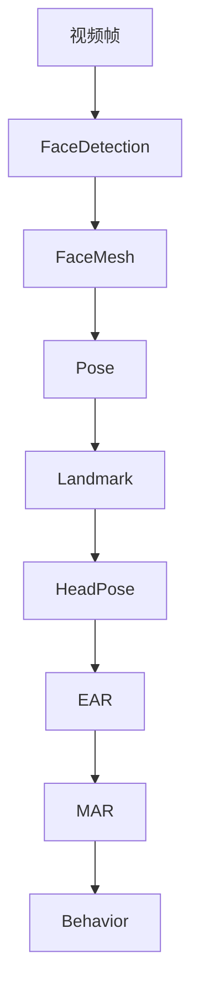

# MediaPipe —— 视觉关键点检测模块设计

## 1. 模块概述

MediaPipe 是 Google 开源的跨平台机器学习框架，提供了高性能、低延迟的视觉感知能力。本项目采用 MediaPipe 作为整个计算机视觉模块的核心组件，负责从摄像头视频中提取学生面部及人体姿态关键点，为后续头部姿态估计、眼部状态分析、疲劳检测和课堂参与度分析提供基础数据。

MediaPipe 具有模型轻量、实时性好、CPU 即可运行、跨平台支持完善等特点，非常适合作为课堂实时监测系统的核心视觉算法。

本模块输出的数据将作为整个系统的数据源，是数据库、行为分析模块及机器学习模型的重要输入。

---

# 2. 模块定位

MediaPipe 位于整个视觉处理流程的核心位置。

```text
USB Camera
      │
      ▼
OpenCV 视频采集
      │
      ▼
Face Detection
      │
      ▼
MediaPipe Face Mesh
      │
      ▼
MediaPipe Pose
      │
      ▼
Head Pose
      │
      ▼
EAR / MAR
      │
      ▼
Fatigue
      │
      ▼
Engagement
```

本模块不负责判断学生状态，仅负责稳定输出视觉关键点。

---

# 3. 技术选型

本项目主要使用 MediaPipe 提供的两个解决方案。

| 模块 | 用途 |
|------|------|
| Face Mesh | 提取人脸468个关键点 |
| Pose | 提取人体33个关键点 |

暂不使用：

- Hands（课堂场景价值较低）
- Holistic（计算量较大，本项目暂不需要）

---

# 4. Face Mesh 模型

Face Mesh 是 MediaPipe 提供的人脸关键点检测模型。

每张人脸可输出 **468 个 Landmark**。

这些 Landmark 能够精确描述：

- 面部轮廓
- 双眼
- 双眉
- 鼻子
- 嘴巴
- 下巴
- 面部三维结构

Face Mesh 输出速度快，适合实时视频分析。

---

# 5. Face Mesh Landmark

Face Mesh Landmark 采用固定编号。

例如：

| 区域 | 示例编号 |
|------|-----------|
| 鼻尖 | 1 |
| 下巴 | 152 |
| 左眼 | 33、133、159、145 等 |
| 右眼 | 362、263、386、374 等 |
| 嘴角 | 61、291 |
| 嘴唇 | 13、14 |

本项目后续所有算法均使用统一 Landmark 编号，不允许自行修改编号。

---

# 6. Pose 模型

MediaPipe Pose 用于获取人体姿态。

输出共 **33 个关键点**。

包括：

- 鼻子
- 双肩
- 双肘
- 双腕
- 双髋
- 双膝
- 双脚

课堂环境下主要使用：

| Landmark | 用途 |
|-----------|------|
| Nose | 判断身体朝向 |
| Left Shoulder | 判断坐姿 |
| Right Shoulder | 判断坐姿 |
| Left Ear | 辅助头部姿态 |
| Right Ear | 辅助头部姿态 |

人体关键点主要用于辅助判断：

- 身体偏移
- 身体离开
- 长时间低头

---

# 7. Landmark 坐标系

MediaPipe 输出归一化坐标。

每个 Landmark 包括：

```text
x

y

z
```

说明：

| 参数 | 范围 | 含义 |
|------|------|------|
| x | 0~1 | 图像宽度方向 |
| y | 0~1 | 图像高度方向 |
| z | 相对深度 | 距离摄像头远近 |

实际计算时需转换为像素坐标。

转换公式：

```python
pixel_x = landmark.x * image_width

pixel_y = landmark.y * image_height
```

后续 Head Pose 等模块均使用像素坐标。

---

# 8. 数据输出结构

本项目统一定义视觉数据结构。

```text
FaceLandmark

├── face_id
├── confidence
├── landmarks(468)
├── bbox
└── roi

PoseLandmark

├── landmarks(33)
├── visibility
└── confidence
```

任何模块不得直接操作 MediaPipe 原始对象，而应统一转换为项目内部数据结构。

---

# 9. 数据流

MediaPipe 数据流如下：



MediaPipe 不直接输出行为结果，仅负责提供关键点数据。

---

# 10. 性能要求

建议运行参数如下：

| 参数 | 建议值 |
|------|---------|
| static_image_mode | False |
| refine_landmarks | True |
| max_num_faces | 10 |
| min_detection_confidence | 0.5 |
| min_tracking_confidence | 0.5 |

推荐分辨率：

```text
640 × 480
```

预计性能：

| 指标 | 要求 |
|------|------|
| Face Mesh FPS | ≥20 FPS |
| Pose FPS | ≥20 FPS |
| CPU 占用 | ≤40% |
| 单帧处理时间 | ≤30 ms |

---

# 11. 模块接口设计

建议统一接口如下：

```python
class MediaPipeProcessor:

    def process(frame):
        """
        输入：
            OpenCV Frame

        输出：
            FaceLandmark
            PoseLandmark
        """
```

输出对象供以下模块直接调用：

- HeadPose
- EyeEAR
- Fatigue
- Engagement

接口保持稳定，不随具体模型变化而变化。

---

# 12. 异常处理

系统需处理以下情况：

| 异常 | 处理方式 |
|------|-----------|
| 未检测到人脸 | 返回空结果 |
| Landmark 丢失 | 插值或跳过当前帧 |
| 遮挡严重 | 标记低置信度 |
| 光照过暗 | 保留上一帧结果（可选） |
| 多人遮挡 | 分别编号处理 |

所有异常均记录日志，不影响系统继续运行。

---

# 13. 后续优化

后续版本计划支持：

- GPU 推理
- 多线程处理
- Face Tracking
- 多摄像头同步
- Landmark 平滑滤波
- 卡尔曼滤波优化关键点抖动

这些优化均建立在当前统一接口之上，无需修改其他模块代码。

---

# 14. 本模块与其他模块关系

MediaPipe 是整个视觉系统的数据中心。

其输出关系如下：

```text
MediaPipe
    │
    ├── HeadPose
    ├── EyeEAR
    ├── MouthMAR
    ├── Fatigue
    ├── Engagement
    ├── Database
    └── Machine Learning
```

所有视觉特征均来源于 MediaPipe 输出的 Landmark 数据，因此本模块应保证接口统一、数据稳定和结果可靠，为整个学生学业状态分析与预警系统提供标准化视觉输入。