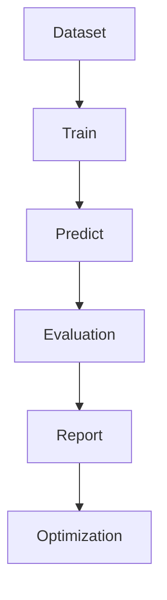

# Evaluation —— 模型评估与性能分析

## 1. 模块概述

模型评估（Evaluation）用于客观评价机器学习模型的预测性能，是整个机器学习流程中不可缺少的重要组成部分。

在本项目中，Evaluation 模块主要负责对 XGBoost（后续扩展至 LSTM）模型进行性能分析，通过标准评价指标衡量模型在学生课堂状态识别与学业风险预测中的准确性、稳定性及泛化能力，为模型优化提供数据依据。

Evaluation 模块不仅用于科研实验，也用于模型版本迭代过程中的效果对比。

---

# 2. 模块定位

Evaluation 位于模型训练之后。

```text
Feature Engineering
        │
        ▼
     XGBoost
        │
        ▼
 Prediction Result
        │
        ▼
    Evaluation
        │
 ┌──────┼─────────────┐
 ▼      ▼             ▼
Metrics Report   Confusion Matrix   ROC Curve
```

Evaluation 不参与模型训练，仅负责评价模型效果。

---

# 3. 评估流程

完整流程如下：



模型训练结束后，首先在测试集上进行预测，再根据预测结果计算各项评价指标。

---

# 4. 数据集说明

模型评估仅使用测试集（Test Set）。

建议划分比例如下：

| 数据集 | 比例 |
|----------|------|
| Train | 70% |
| Validation | 15% |
| Test | 15% |

要求：

- 测试集数据不得参与训练；
- 保证类别分布均衡；
- 同一学生的数据不得同时出现在训练集和测试集中。

---

# 5. 混淆矩阵（Confusion Matrix）

混淆矩阵用于分析模型分类情况。

示例：

| 实际\\预测 | Normal | Attention | Fatigue | Risk |
|-----------|--------|-----------|----------|------|
| Normal | 90 | 4 | 2 | 1 |
| Attention | 6 | 84 | 5 | 2 |
| Fatigue | 2 | 5 | 87 | 3 |
| Risk | 1 | 2 | 4 | 93 |

混淆矩阵能够直观展示：

- 正确分类数量；
- 错误分类方向；
- 哪些类别容易混淆。

---

# 6. Accuracy（准确率）

准确率表示预测正确样本占全部样本的比例。

计算公式：

```text
Accuracy

=

预测正确样本数

/

全部样本数
```

适用于类别分布相对均衡的数据集。

评价标准：

| Accuracy | 评价 |
|-----------|------|
| ≥95% | 优秀 |
| 90%~95% | 良好 |
| 80%~90% | 一般 |
| <80% | 需要优化 |

---

# 7. Precision（精确率）

Precision 表示模型预测为某类别时，预测结果的可信程度。

公式：

```text
Precision

=

TP

/

(TP+FP)
```

Precision 越高，误报越少。

课堂预警系统中，高 Precision 可以减少错误预警，提高教师对系统的信任度。

---

# 8. Recall（召回率）

Recall 表示模型发现目标样本的能力。

公式：

```text
Recall

=

TP

/

(TP+FN)
```

Recall 越高，漏检越少。

对于高风险学生检测而言，应优先保证 Recall，避免遗漏真正需要关注的学生。

---

# 9. F1-Score

F1 是 Precision 与 Recall 的综合指标。

公式：

```text
F1

=

2×

Precision×

Recall

/

(Precision+Recall)
```

F1 越高表示模型综合性能越好。

科研论文中通常同时报告：

- Precision
- Recall
- F1

三项指标。

---

# 10. ROC 曲线与 AUC

对于概率输出模型，还需要评估 ROC 曲线。

ROC 曲线描述：

```text
真正率（TPR）

与

假正率（FPR）

之间关系
```

AUC（Area Under Curve）表示 ROC 曲线下面积。

评价标准：

| AUC | 评价 |
|------|------|
| ≥0.95 | 优秀 |
| 0.90~0.95 | 良好 |
| 0.80~0.90 | 可接受 |
| <0.80 | 需要优化 |

---

# 11. PR 曲线

由于课堂风险数据可能存在类别不平衡问题，仅使用 ROC 曲线不足以全面评价模型。

因此建议同时绘制 Precision-Recall（PR）曲线。

PR 曲线能够更加准确地反映：

- 高风险学生检测能力；
- 少数类别预测性能。

---

# 12. 模型对比

项目后续可能引入多种模型。

建议统一评价：

| 模型 | Accuracy | Precision | Recall | F1 | AUC |
|------|-----------|-----------|---------|-----|-----|
| Decision Tree | - | - | - | - | - |
| Random Forest | - | - | - | - | - |
| XGBoost | - | - | - | - | - |
| LSTM | - | - | - | - | - |

便于论文实验章节进行横向比较。

---

# 13. 可视化输出

Evaluation 模块建议输出以下图表：

- 混淆矩阵热力图
- ROC 曲线
- PR 曲线
- Feature Importance 图
- SHAP Summary Plot
- Precision、Recall、F1 对比柱状图

所有图片统一保存：

```text
outputs/reports/

evaluation/
```

便于论文和项目汇报使用。

---

# 14. 模块输出

Evaluation 最终生成统一评估报告。

建议内容：

```text
Evaluation Report

├── Accuracy
├── Precision
├── Recall
├── F1
├── ROC-AUC
├── PR-AUC
├── Confusion Matrix
├── Model Version
└── Evaluation Time
```

报告可导出为 Markdown、PDF 或 HTML 格式。

---

# 15. 后续优化

随着项目的发展，Evaluation 模块将进一步完善：

1. 引入 K 折交叉验证（K-Fold Cross Validation），提高模型评估稳定性；
2. 增加模型推理速度、内存占用等工程性能指标；
3. 支持不同版本模型自动对比，形成实验记录；
4. 建立自动化评估流水线，每次模型训练完成后自动生成评估报告；
5. 为 LSTM、Transformer 等后续模型提供统一的评价标准，确保不同模型之间具有可比性。

Evaluation 模块是机器学习开发的重要质量保障，通过统一、规范的评价指标体系，可以客观反映模型性能，为模型优化、论文实验分析和系统迭代提供可靠依据。