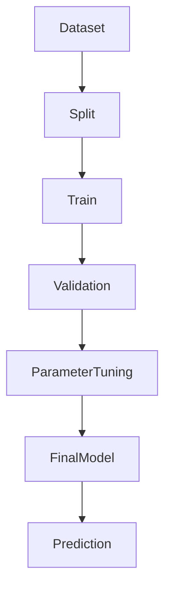

# XGBoost —— 学业风险预测模型设计

## 1. 模块概述

XGBoost（Extreme Gradient Boosting）是本项目第一阶段采用的核心机器学习模型，主要用于根据课堂视觉行为特征预测学生当前课堂状态及潜在学业风险。

相比神经网络模型，XGBoost具有训练速度快、样本需求较少、对缺失值具有较好的容忍能力、模型可解释性较强等优点，非常适合作为本项目 V0.3 版本的首个智能预测模型。

本模块不直接处理视频，而是读取 Feature Engineering 模块输出的结构化特征向量，输出学生课堂状态预测结果及风险概率。

---

# 2. 模块定位

XGBoost 位于整个数据分析流程的预测层。

```text
Camera
    │
    ▼
CV Modules
    │
    ▼
Feature Engineering
    │
    ▼
XGBoost Model
    │
    ├────────► Risk Probability
    ├────────► Dashboard
    ├────────► Warning System
    └────────► SHAP Explainability
```

模型只负责预测，不负责数据采集。

---

# 3. 为什么选择 XGBoost

项目初期比较了多种机器学习算法。

| 算法 | 优点 | 缺点 |
|------|------|------|
| Decision Tree | 简单易理解 | 易过拟合 |
| Random Forest | 稳定 | 模型较大 |
| SVM | 小样本效果好 | 大规模数据训练慢 |
| Logistic Regression | 可解释 | 表达能力有限 |
| Neural Network | 能力强 | 数据需求大 |
| **XGBoost** | 高精度、速度快、支持特征重要性分析 | 参数较多 |

综合考虑科研周期、数据规模及可解释性，本项目选择 XGBoost 作为第一阶段核心模型。

---

# 4. 模型输入

模型输入来自 Feature Engineering 模块。

主要特征包括：

| 特征名称 | 描述 |
|-----------|------|
| ear_mean | 平均 EAR |
| ear_std | EAR 标准差 |
| blink_rate | 眨眼频率 |
| perclos | 闭眼比例 |
| pitch_mean | 平均 Pitch |
| yaw_mean | 平均 Yaw |
| roll_mean | 平均 Roll |
| fatigue_score | 疲劳评分 |
| attention_score | 课堂参与度 |
| head_down_duration | 累计低头时间 |
| face_lost_duration | 离开画面时间 |

所有输入特征均已完成归一化处理。

---

# 5. 模型输出

本项目采用分类模型。

输出：

```text
Risk Probability

0~1
```

例如：

| 概率 | 判断 |
|------|------|
| 0.08 | 正常 |
| 0.37 | 轻度风险 |
| 0.71 | 中度风险 |
| 0.94 | 高风险 |

最终系统根据概率生成预警等级。

---

# 6. 标签设计

监督学习需要人工标签。

建议分类如下：

| Label | 含义 |
|--------|------|
| 0 | 正常课堂状态 |
| 1 | 注意力下降 |
| 2 | 疲劳状态 |
| 3 | 高风险状态 |

标签可来源于：

- 教师课堂观察记录
- 视频人工标注
- 多人交叉审核结果

后续可结合成绩变化进行长期标签修正。

---

# 7. 数据集划分

建议划分比例：

| 数据集 | 比例 |
|----------|------|
| Train | 70% |
| Validation | 15% |
| Test | 15% |

划分原则：

- 同一学生数据不跨数据集；
- 保持类别均衡；
- 划分前完成去重与异常值清洗。

---

# 8. 模型训练流程



训练流程包括：

1. 数据读取；
2. 数据划分；
3. 模型训练；
4. 参数优化；
5. 模型保存；
6. 在线预测。

---

# 9. 参数设置

建议初始参数如下：

| 参数 | 建议值 |
|------|---------|
| objective | multi:softprob |
| num_class | 4 |
| max_depth | 6 |
| learning_rate | 0.1 |
| n_estimators | 200 |
| subsample | 0.8 |
| colsample_bytree | 0.8 |
| gamma | 0 |
| min_child_weight | 1 |
| random_state | 42 |

上述参数作为初始值，可根据实验结果进一步优化。

---

# 10. 参数调优

采用 Grid Search 进行超参数搜索。

重点优化：

| 参数 | 搜索范围 |
|------|-----------|
| max_depth | 3~10 |
| learning_rate | 0.01~0.3 |
| n_estimators | 100~500 |
| subsample | 0.6~1.0 |
| colsample_bytree | 0.6~1.0 |

评价指标以 Validation Set 为准。

---

# 11. 模型保存

训练完成后保存模型。

建议目录：

```text
models/

best/

xgboost_model.json
```

同时保存：

```text
feature_names.json

label_mapping.json

training_config.yaml
```

便于后续部署与模型更新。

---

# 12. 在线预测流程

```text
Camera

↓

Feature Engineering

↓

Feature Vector

↓

XGBoost

↓

Risk Probability

↓

Warning
```

系统每完成一个时间窗口，即可进行一次预测。

建议：

```text
30 秒窗口

每秒更新一次预测
```

---

# 13. 风险等级划分

根据预测概率生成风险等级。

| Risk Probability | 风险等级 |
|------------------|----------|
| <0.30 | 正常 |
| 0.30~0.60 | 关注 |
| 0.60~0.80 | 预警 |
| >0.80 | 高风险 |

不同等级对应不同提示策略。

---

# 14. 与其他模块关系

```text
Feature Engineering
        │
        ▼
    XGBoost
        │
 ┌──────┼───────────┐
 ▼      ▼           ▼
SHAP  Dashboard  Warning
```

其中：

- Feature Engineering 提供输入特征；
- SHAP 提供模型解释；
- Dashboard 展示预测结果；
- Warning System 根据预测结果触发预警。

---

# 15. 后续优化

当前版本采用 XGBoost 作为课堂状态预测模型，具有训练效率高、可解释性好、易于部署等优点，适合作为项目第一阶段的智能分析核心。

随着数据规模的增加，后续计划逐步升级模型能力：

1. 引入交叉验证和自动超参数优化，提高模型泛化能力；
2. 使用类别权重或重采样方法解决类别不平衡问题；
3. 增加时间统计特征和行为序列特征，提高预测准确率；
4. 结合 SHAP 分析特征贡献，提升模型可解释性；
5. 在项目 V1.0 中引入 LSTM，对学生长期课堂行为序列进行建模，实现风险趋势预测。

XGBoost 模块是本项目机器学习部分的第一阶段核心模型，其输出的风险概率将作为课堂预警、可视化展示和学业状态分析的重要依据，为后续深度学习模型的引入奠定基础。